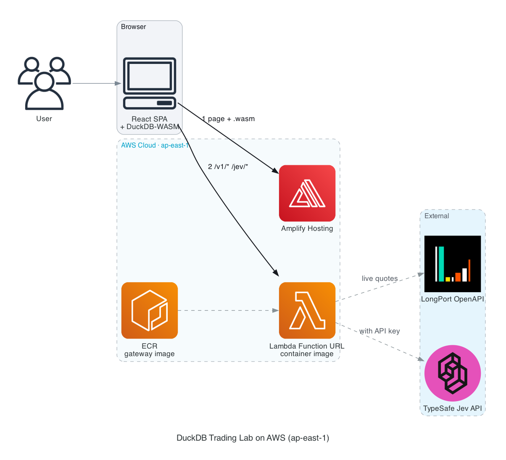

# Running DuckDB-WASM + Custom Extensions on AWS: Amplify + Lambda Function URL

> Draft for AWS Builder Center. Live demo: https://main.dmj5x8o24lu58.amplifyapp.com/
> (region: ap-east-1, Hong Kong)

## What we built

A browser-based trading terminal where **DuckDB runs entirely in the browser** (DuckDB-WASM)
and two custom DuckDB extensions turn external APIs into SQL:

- `longbridge` extension — market data as table functions:
  `SELECT * FROM longbridge_history_bars('700.HK', 'day', DATE '2026-08-21', DATE '2026-09-21')`
- `jev` extension — AI trade signals as scalar functions (`jev_ask`, `jev_choice`), so a query can
  return `buy/hold/sell` with confidence scores next to the OHLC bars.

There is **no server-side database**. The only backend is a small stateless JSON gateway that
proxies the market-data and AI APIs.

## Architecture



Two AWS services, nothing else:

| Component | AWS service | Purpose |
|---|---|---|
| Static SPA + extension `.wasm` files | **Amplify Hosting** | serves `dist/` (React app) and `/v1.5.4/wasm_eh/*.duckdb_extension.wasm` |
| Quote/AI gateway | **Lambda Function URL** (auth `NONE`), container image from **ECR** | Node.js 22, the same code as the local dev sidecar, **live LongPort quotes** |

Deliberately **not** used: API Gateway (Function URL is enough for one service), Route 53 /
CloudFront (default `amplifyapp.com` domain for a demo), Secrets Manager (credentials are plain
Lambda env vars in this demo), VPC (no private resources).

Request flow:

1. Browser loads the SPA and the two extension `.wasm` files from Amplify.
2. DuckDB-WASM engine bundles come from jsDelivr CDN (the official distribution channel).
3. SQL calling `longbridge_*()` / `jev_*()` makes HTTPS calls to the Lambda Function URL
   (`/v1/quote/*`, `/jev/*`). With `LONGPORT_*` credentials set, the gateway streams **live quotes
   from LongPort OpenAPI** (protobuf-over-WebSocket via the official napi SDK); without them it
   serves deterministic synthetic data. Jev answers are proxied to TypeSafe when an API key is
   sent, synthetic otherwise.

## The one refactoring that made Lambda trivial

The local dev gateway was a plain `node:http` server (`server.js`). Instead of pulling in a
framework or a Lambda adapter layer, we extracted a **transport-agnostic pure function**:

```js
// handler.js — shared by the local server AND Lambda
export async function handleRequest({ method, url, headers, body }) {
  // ... routing for /v1/quote/*, /v1/asset/*, /jev/*, /healthz ...
  return { status, headers, body };   // CORS headers included here
}
```

```js
// lambda.js — the entire AWS-specific code (~20 lines)
import { handleRequest } from './handler.js';

export async function handler(event) {
  const method = event.requestContext?.http?.method ?? 'GET';
  const url = new URL(
    (event.rawPath ?? '/') + (event.rawQueryString ? `?${event.rawQueryString}` : ''),
    'https://lambda.local',
  );
  let body = event.body;
  if (event.isBase64Encoded && body) body = Buffer.from(body, 'base64').toString('utf8');
  const out = await handleRequest({ method, url, headers: event.headers ?? {}, body });
  return { statusCode: out.status, headers: out.headers, body: out.body };
}
```

Notes that matter:

- **Repeated query params survive**: Function URLs expose `rawQueryString`, so
  `?symbol=700.HK&symbol=AAPL.US` keeps both values (URLSearchParams `getAll`).
- **CORS stays in app code**: the handler returns `access-control-allow-origin: *` and answers
  `OPTIONS` itself. Do *not* also configure CORS on the Function URL — the platform would
  duplicate the headers and browsers reject the response.
- The same `handler.js` served three transports unchanged: local `node:http`, a Lambda zip handler
  (`lambda.js` above, demo mode), and finally the container image (Lambda Web Adapter →
  `server.js`) we run in production for live quotes.

## Zip first, then a container image: the glibc wall

Our first deploy was a **7 KB zip** on the managed `nodejs22.x` runtime — the LongPort SDK is a
napi native module, only needed in live mode, loaded via `await import('longport')` and marked
`--external` at bundle time. Demo mode (synthetic data) worked instantly.

Turning on **live quotes** hit a hard wall:

```
/lib/aarch64-linux-gnu/libc.so.6: version `GLIBC_2.39' not found
```

The SDK's prebuilt linux-gnu binaries (both x64 and arm64) require **glibc 2.39**, but the managed
Lambda runtimes run on Amazon Linux 2023 with **glibc 2.34**. No managed Node.js runtime can load
it. The fix is a **container image** on a newer base, with the Lambda Web Adapter bridging the
Runtime API to the plain HTTP sidecar — so the code deployed is literally `server.js` unchanged:

```dockerfile
# demo/sidecar/Dockerfile.lambda
FROM public.ecr.aws/awsguru/aws-lambda-adapter:0.9.1 AS adapter
FROM node:22-trixie-slim                 # glibc 2.41 >= 2.39
COPY --from=adapter /lambda-adapter /opt/extensions/lambda-adapter
ENV PORT=8080
WORKDIR /app
COPY package.lambda.json ./package.json
COPY server.js handler.js ./
COPY lib ./lib
COPY lambda-pkg/node_modules ./node_modules   # linux-arm64-gnu napi binary
CMD ["node", "server.js"]
```

Two packaging tricks keep the image small:

- `npm install longport --os=linux --cpu=arm64 --libc=glibc` fetches only the matching napi
  platform package on a macOS dev machine.
- The prebuilt `.node` ships **unstripped — 551 MB**, over Lambda's 250 MB unzipped image layer
  budget concerns and slow to pull. A Docker-based `strip -s` (alpine + binutils, one command)
  shrinks it to **59 MB** with zero functional loss:

```bash
docker run --rm --platform linux/arm64 -v "$PWD/node_modules/longport-linux-arm64-gnu":/w \
  alpine sh -c "apk add --quiet binutils && strip -s /w/longport.linux-arm64-gnu.node"
```

## Deploy commands (as actually run)

```bash
# 1. Build + push the gateway image (arm64 native build on Apple Silicon)
cd demo/sidecar
aws ecr create-repository --region ap-east-1 --repository-name duck-trader-gateway
aws ecr get-login-password --region ap-east-1 | \
  docker login --username AWS --password-stdin <ACCOUNT>.dkr.ecr.ap-east-1.amazonaws.com
docker buildx build --platform linux/arm64 --provenance=false --sbom=false \
  -f Dockerfile.lambda -t <ACCOUNT>.dkr.ecr.ap-east-1.amazonaws.com/duck-trader-gateway:latest \
  --push .

# 2. Lambda (image) + public Function URL (ap-east-1)
aws lambda create-function --region ap-east-1 --function-name duck-trader-gateway \
  --package-type Image \
  --code ImageUri=<ACCOUNT>.dkr.ecr.ap-east-1.amazonaws.com/duck-trader-gateway:latest \
  --role arn:aws:iam::<ACCOUNT>:role/duck-trader-gw-role \
  --architectures arm64 --timeout 30 --memory-size 512 \
  --environment "Variables={LONGPORT_APP_KEY=...,LONGPORT_APP_SECRET=...,LONGPORT_ACCESS_TOKEN=...}"
aws lambda create-function-url-config --region ap-east-1 \
  --function-name duck-trader-gateway --auth-type NONE
aws lambda add-permission --region ap-east-1 --function-name duck-trader-gateway \
  --statement-id FunctionURLAllowPublicAccess --action lambda:InvokeFunctionUrl \
  --principal '*' --function-url-auth-type NONE
aws lambda add-permission --region ap-east-1 --function-name duck-trader-gateway \
  --statement-id FunctionURLInvokeViaUrl --action lambda:InvokeFunction \
  --principal '*' --invoked-via-function-url

# 3. Frontend: inject the gateway URL at build time
cd ../web
VITE_GATEWAY_URL=https://<id>.lambda-url.ap-east-1.on.aws npm run build

# 4. Amplify: app + SPA rewrite + manual zip deploy
aws amplify create-app --region ap-east-1 --name duck-trader --platform WEB \
  --custom-rules '[{"source":"</^[^.]+$|\\.(?!(css|gif|ico|jpg|js|png|txt|svg|woff|woff2|ttf|map|json|wasm)$)([^.]+$)/>","target":"/index.html","status":"200"}]'
aws amplify create-branch --region ap-east-1 --app-id <APP_ID> --branch-name main
cd dist && zip -qr site.zip . && cd ..
DEPLOY=$(aws amplify create-deployment --region ap-east-1 --app-id <APP_ID> --branch-name main \
  --query '{jobId:jobId,url:zipUploadUrl}' --output json)
curl -X PUT -T dist/site.zip -H 'Content-Type: application/zip' \
  "$(echo $DEPLOY | jq -r .url)"
aws amplify start-deployment --region ap-east-1 --app-id <APP_ID> --branch-name main \
  --job-id "$(echo $DEPLOY | jq -r .jobId)"
```

## Gotchas we hit (so you don't have to)

1. **Managed Lambda runtimes can't load modern napi binaries.** LongPort's SDK needs glibc 2.39;
   AL2023 has 2.34. If your dependency is a prebuilt native module, check its `GLIBC_` requirements
   (`grep -ao 'GLIBC_2\.[0-9]*' binary.node | sort -Vu`) before choosing zip vs container image.
2. **Docker Desktop pushes images Lambda rejects** ("image manifest, config or layer media type …
   not supported") — containerd-store builds attach OCI attestations. Fix:
   `docker buildx build --provenance=false --sbom=false --push`.
3. **A fresh Function URL stays `Forbidden` for a while** even with the correct resource policy
   (`lambda:InvokeFunctionUrl` + `lambda:FunctionUrlAuthType: NONE` condition — the condition is
   mandatory, the CLI rejects the statement without it). On our image-based function we also needed
   `lambda:InvokeFunction` with `--invoked-via-function-url`. Re-add the permission and wait a
   minute before debugging anything else.
4. **Amplify rewrite rule must exclude `.wasm`**, otherwise extension downloads get rewritten to
   `index.html`. Verify with
   `curl -I https://<app>.amplifyapp.com/v1.5.4/wasm_eh/longbridge.duckdb_extension.wasm` →
   expect `content-type: application/wasm`.
5. **Pending Amplify jobs block new deployments.** If `create-deployment` fails with
   "The last job was not finished", `stop-job` the stale ones first.
6. **The frontend needs the gateway origin at build time.** In dev, Vite proxies `/v1` and `/jev`
   to localhost; on AWS those paths don't exist on Amplify, so `VITE_GATEWAY_URL` points the app
   (and the DuckDB secrets it creates) at the Function URL.

## Verification

End-to-end check (headless Chrome, Puppeteer) against the live Amplify URL — note `close: 430`,
the real Tencent quote, vs 645 in synthetic mode:

```
remote target https://main.dmj5x8o24lu58.amplifyapp.com is up
both extension pills report loaded
query finished in 1.0s (wall clock)
first row: ["2026-09-20 16:00:00.000","430","436.92","sell","0.3439",…]
result grid: 10 rows, headers: timestamp, close, ma20, signal.action, …, next_day_pnl_pct
PASS
```

And the gateway itself:

```
GET /healthz → {"status":"ok","mode":"live","jev":"synthetic"}
GET /v1/quote/quote?symbol=700.HK → last_done 450.6, prev_close 430.0   ← real LongPort data
```

## Cost profile

Everything sits in free tier for a demo: Amplify Hosting (5 GB stored / 15 GB served per month),
Lambda (1M requests + 400,000 GB-seconds), ECR (500 MB), no NAT, no VPC, no database. The DuckDB
engine is served by jsDelivr at no cost to us.

## Live endpoints

- App: https://main.dmj5x8o24lu58.amplifyapp.com/
- Gateway health: https://cqbfpx4b3v3izlq6nevnguv3si0oozbl.lambda-url.ap-east-1.on.aws/healthz
- Reference deployment (Cloudflare Workers variant): https://duck-trader.jetsquirrel.cloud/
